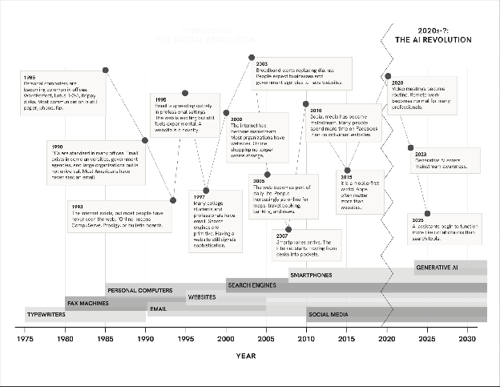

::: keypoints
- More detail and local examples to go with the AI-related decisions section.
- Covers technology’s acceleration, how many AI decisions local public bodies have made, more on regulation, and more on La Pine’s data center decision.
:::

## Technology’s acceleration

*See also: [What are we talking about when we say “AI”?](#what-is-ai)*

::: figure

Technology’s acceleration, 1975 to 2030: from typewriters and fax machines through the early web and smartphones to the generative AI era. From the Utah Solutions Forum briefing book.
:::

## How many AI decisions?

*See also: [What AI-related decisions are happening in Central Oregon?](#range-of-decisions)*

Our research found about 29 AI-related decisions made by public bodies affecting Deschutes, Crook, and Jefferson counties between late 2023 and October 2026. These decisions ranged across data centers, policing, schools, government operations, and more ([Central Oregon Decisions tracker](https://docs.google.com/spreadsheets/d/19zmUMXSqIPJhdJZTfiAFqM_DHhTYhB1pbOovrmJVmks/edit?gid=1770817539#gid=1770817539)).

## Regulations: more detail

*See also: [Regulations](#regulations)*

- **Key documents:** Laws (statutes), local ordinances, administrative rules, and utility commission orders.
- **Utility commission cases** allow consumer groups (like the Citizens’ Utility Board) and others to formally participate in decisions about who pays for new power infrastructure.

## La Pine: more detail

*See also: [Data centers in Prineville vs. La Pine](#case-data-centers)*

- Because Deschutes County owns the land in the La Pine Industrial Park, the county commission would also have needed to approve the sale.
- Some reports describe a citizen ballot measure on future data center projects at the site for the November 2026 election.

## Questions to consider

*See also: [What makes AI-related decisions different?](#what-makes-ai-different)*

- What is different about AI decisions?
- What other kind of decision is it most similar to?
