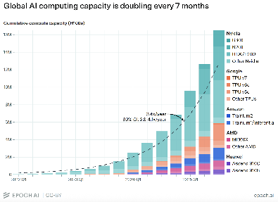

::: keypoints
- AI depends on a physical system: internet connections, specialized chips, data centers, and electricity.
- Data centers store data, run everyday apps, and, newest of all, train AI models.
- One prompt uses little power. The local impact comes from the data center itself, which can use as much electricity as tens of thousands of homes.
- Data centers used about 23% of Oregon’s retail electricity sales in 2025, and information on their water use is often incomplete.
:::

AI is more than just the apps on our phones and computers. To make applications like Claude and ChatGPT possible, it requires a large physical system behind the scenes.

| Piece | What it is | Why it matters locally |
| --- | --- | --- |
| **Internet** | The fiber-optic cables and networks that carry your request to a data center and bring the answer back | Fast, reliable connections are one reason companies choose a location |
| **Chips** | Specialized computer chips are like the “brains” of AI. A single chip can perform trillions of calculations per second | Making chips takes factories, water, and minerals. Oregon has a large chip industry (see below) |
| **Data centers** | Buildings full of computers (with chips) that process requests and send answers back to users | They need land, water for cooling, and huge amounts of electricity |
| **Power** | The electricity that runs and cools the computers | Data centers tend to consume a lot of electricity, which can affect the grid and power bills |

## What do data centers do?

Data centers are not new. They have been the backbone of the internet for decades (adapted from the Utah Briefing Book). They do three main jobs:

1. **Store and retrieve data (“cloud computing”).** This is the most familiar use of data centers, and what the current AI industry is built on. Even before the AI industry took off, data centers were needed to store the data for websites, stream videos on sites like YouTube, and back up photos and email. Over the past few decades, more and more of our information has been stored in data centers.
2. **Run calculations for everyday apps (“inference”).** Data centers have always done the computing behind everyday apps. When you search for something on Google, the algorithms that power the search run on a computer in a data center. Each time someone asks an AI chatbot a question, a data center does that work too.
3. **Train AI models.** This is the newest use for data centers. Training a large model can take thousands of specialized chips running nonstop for weeks or months.

Demand for data centers has increased significantly as AI has taken off. The hardware has changed too. A regular rack of computer servers draws 5 to 10 kilowatts of power, while a rack built for AI draws 40 to 80 kilowatts or more (Pew Research Center, citing IEA, 2024, as cited in the Utah Briefing Book).

::: figure

Global AI computing capacity is doubling roughly every seven months, growing about 3.3 times per year since 2022. That growth is what drives demand for new data centers. Source: [Epoch AI](https://epoch.ai/data-insights/ai-chip-production).
:::

## Some nuance: individual vs. local vs. corporate use

It helps to separate three different scales of AI energy use:

- **Individual:** A single AI prompt uses about as much electricity as a 10-watt LED bulb running for 90 seconds. One person’s daily use is small (Digit.in, 2025, as cited in the Utah Briefing Book).
- **Local:** The impact on a community comes from the data center itself. A single large facility can use as much electricity as tens of thousands of homes, all in one place. That is why data centers have become local questions about land, water, power lines, and permits.
- **Corporate:** Most of the demand comes from AI companies and cloud providers (like Amazon, Microsoft, Google, and Meta), which use electricity both to build AI models and to run them for millions of users at once (adapted from the Utah Briefing Book).

## Power: how much electricity?

- **Nationally:** U.S. data centers used about 4.4% of the nation’s electricity in 2023 (Pew Research Center, citing IEA, 2024, as cited in the Utah Briefing Book).
- **In Oregon:** Data centers used about 23% of the state’s retail electricity sales in 2025. That share is expected to grow to 31 to 32% by 2030, or about 25 terawatt-hours a year, enough to power about 2.5 million homes ([OPB](https://www.opb.org/article/2026/09/17/oregon-data-centers-consume-quarter-state-power-report/)). Oregon’s data centers already use electricity equal to about 71% of all the electricity sold to Oregon homes ([KPTV](https://www.kptv.com/2026/09/21/report-finds-oregon-data-centers-used-electricity-equal-over-70-all-homes-state/)). {new: }
- **In Prineville:** Meta and Apple have paid for public infrastructure, including an underground water storage system and solar farms in the high desert to help meet their energy needs ([Marketplace](https://www.marketplace.org/story/2026/10/21/apple-and-meta-data-centers-divide-oregon-towns-residents)).

The ECOnorthwest report also found that information on data centers’ **water use** is inconsistent, incomplete, or unavailable ([OPB](https://www.opb.org/article/2026/09/17/oregon-data-centers-consume-quarter-state-power-report/)). Content committee members cited ECOnorthwest at 23%+ of retail electricity demand today and 33.6% projected by 2030 {src: Member input v.3, Oct 7}. {check: OPB reports “31 to 32%” by 2030; reconcile with the 33.6% figure using the ECOnorthwest report itself.}

## The supply chain in Oregon

Oregon is also part of the AI supply chain beyond data centers. The state has a large semiconductor (chip) industry, led by Intel. In Central Oregon, BASX in Redmond builds equipment for data centers. A $160 million, 10-year federal (NSF) grant to the FAST partnership supports semiconductor startups {src: CC Mtg 4 Pt 1, Oct 14}. {check: Confirm BASX’s product line and the grant details before publishing.}
