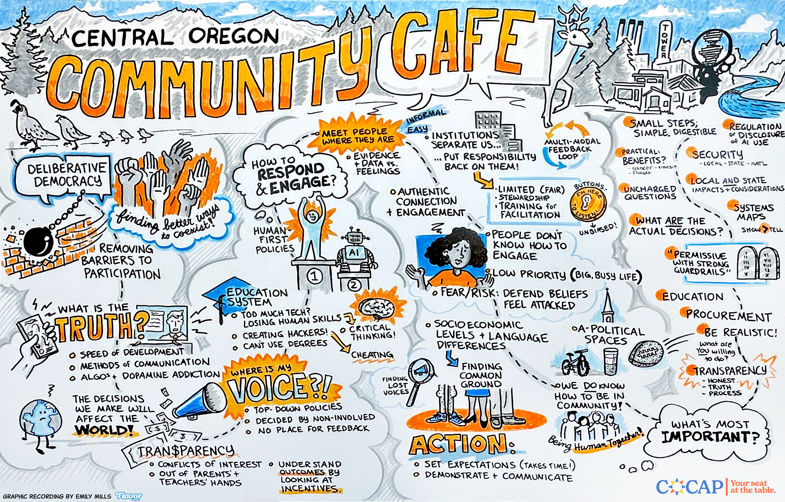

::: figure

Graphic recording from the Central Oregon Community Cafe.
:::

## What are we talking about?

::: lead-strong
**The guiding question: “How should the people of Central Oregon be involved in local and state decisions related to AI technology and infrastructure?”**
:::

This question came through thorough engagement with the Central Oregon community. [Polling and conversations](http://report.bloomproject.us/central-oregon-ai) across Central Oregon in spring 2026 surfaced two priorities: a desire for greater community involvement in decision-making, and AI technology and infrastructure as a topic of particular concern. The Civic Assembly on AI brings the two together.

Artificial intelligence is a rapidly developing technology that will likely have far-reaching consequences for our personal lives, the economy, and more. Whether you are optimistic, pessimistic, or unsure about what a future with more AI will bring, many people agree that the people of Central Oregon will be well served by figuring out how the public can best engage on these issues. That matters before decisions are made that are likely to affect land and other natural resources, the education of Central Oregon’s youth and future workforce, our towns, our ability to work and do business, and more.

Through these deliberations, we will think together about what we want our future to be, what accountability by government to the public means and requires, and what specific steps we can take as voters and taxpayers to ensure Central Oregon’s elected representatives are prepared to shepherd AI-related changes in a direction that enables the pursuit of life, liberty, and happiness for everyone.

**A note for delegates.** As a Civic Assembly delegate, you will arrive with perspectives about AI that may differ from those around you. Some may support new AI data centers; others may oppose them. These are important issues, but the Assembly is *not* designed to settle those particular debates.

Instead, delegates will consider **how the people of Central Oregon can have a meaningful voice in decisions about AI**, whether those decisions are made by local or state governments, school districts, or other institutions. AI offers one focused, timely topic within the much larger universe of decisions that shape our communities. In the end, delegates will offer a community-centered perspective on how to engage and involve residents when local and state decisions related to AI are made.

## How to use these learning materials

In preparation for this Civic Assembly, the Central Oregon Civic Action Project engaged with a wide range of public servants, community-based organizations, community engagement experts, and more.

The materials are divided into a few key sections:

- **[AI-related decisions](#what-is-ai),** laying out the different kinds of decisions that our state and local governments are making related to AI
- **[Public engagement](#goal-of-engagement),** covering how and when the public is able to influence these decisions
- **[Case studies](#lessons-from-elsewhere)** on what has worked for other places, and what could still be better

You are not expected to read every word of these materials. Instead, we have broken them up based on the smaller questions they can help you answer. Feel free to jump around to the different questions and sections.

During the Assembly, live presentations and discussions will further support shared understanding. Assembly staff will be able to help find answers to any questions that come up during the discussions, and local subject-matter experts will also be there to answer more specific questions.

If you have any questions before then, please add them to the [Question Board](https://docs.google.com/forms/d/e/1FAIpQLSeccalq6FQQrRKFha2XeWcYJPI8tSGsH-N0KnmmRtyE9NT75A/viewform?usp=publish-editor), where they may also be shared with other delegates to support broader learning. You can also email Delegate Concierge Mickie Derting directly at [mickie@cocap.us](mailto:mickie@cocap.us).
