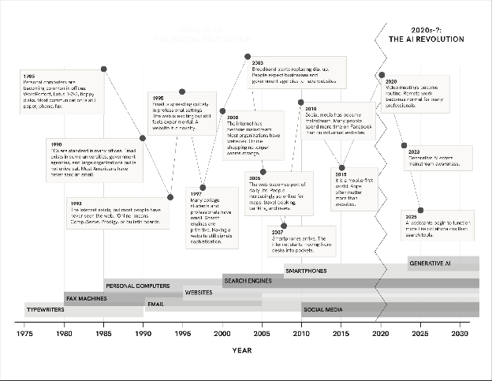

::: keypoints
- AI is a broad term for computer systems that can perform tasks with human-like intelligence, like understanding language or recognizing images.
- Most AI tools run on models: giant sets of numbers that capture patterns in training data, built by a handful of large labs and companies.
- AI isn’t new, but today’s large language models are far more flexible. ChatGPT’s release in late 2022 brought them to the public.
- Companies are now building AI agents that take actions on their own. Experts disagree about how far and how fast this will go.
:::

*In short, artificial intelligence (AI) is “a broad term for computer systems that can perform tasks with human-like intelligence, such as understanding language, recognizing images, learning from data, reasoning, and making decisions”* ([Stanford HAI](https://hai.stanford.edu/ai-definitions/what-is-artificial-intelligence-ai)).

*Unlike traditional software, which follows rules written step by step by programmers, modern AI systems “learn” from data. They find patterns across millions or billions of examples and use those patterns to make predictions or responses in new situations* (adapted from the Utah Briefing Book).

## The core technology: models

Most of today’s AI tools run on **models**. A model is essentially just very complex statistics. It is a giant set of numbers that captures the patterns found in the data it was trained on.

- **Who builds them:** Models are developed by AI research labs and large corporations, such as OpenAI, Anthropic, Google, Meta, and Microsoft.
- **What they need:** Building (or “training”) a model requires a massive amount of data, along with huge amounts of computing power and electricity.
- **How we use them:** Most people never touch a model directly. Instead, they use an app (like ChatGPT, Claude, Microsoft Copilot, or a school tool like MagicSchool) that sends their request to a model running in a data center somewhere else.

## How is this different from what already existed?

**Before:** AI was already being used for all sorts of things long before ChatGPT. Recommendation algorithms on social media, search engines, spam filters, GPS directions, and voice assistants like Siri and Alexa all use AI. Most people used it every day without thinking of it as “AI.”

**Now:** Today’s models are significantly more flexible and capable than before. Large language models (LLMs) can turn plain-English requests (“prompts”) into all sorts of other outputs: written documents, computer code, images, spreadsheets, summaries, and translations. The turning point for public awareness came in late 2022 with the release of ChatGPT. For the first time, millions of people could talk directly with an AI system that could write, answer questions, and create (adapted from the Utah Briefing Book).

::: figure

Technology’s acceleration, 1975 to 2030: from typewriters and fax machines through the early web and smartphones to the generative AI era. From the Utah Solutions Forum briefing book.
:::

## What can it do?

| Kind of work | Examples |
| --- | --- |
| **Standard tasks** | Drafting emails, summarizing long documents, creating spreadsheets, taking meeting notes |
| **Research** | Producing research reports, analyzing data, answering questions about a large set of documents |
| **Creative work** | Producing images and videos, or helping with key steps in an artist’s workflow that aren’t just producing the art itself (like brainstorming, editing, or captioning) |

## What *could* it do?

AI companies are now building **“AI agents.”** These are systems that don’t just answer questions but take actions on their own, like booking appointments, filling out forms, or writing and running computer code. Some researchers and companies believe AI may eventually match or exceed human abilities across most tasks. Others are skeptical. Experts disagree significantly about when, or whether, this might happen (Stanford HAI, 2025, as cited in the Utah Briefing Book).
